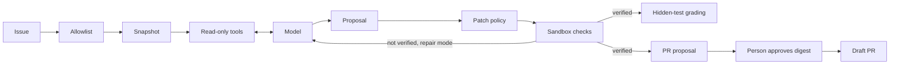

# PatchPilot AI

PatchPilot AI is an autonomous software maintenance agent with the brakes
built in. Given a bug report for an approved Python repository, it reads a
pinned snapshot, lets a language model propose one fix with a regression
test, checks the fix in a locked-down sandbox, can repair its own proposal
from the test feedback, and produces an evidence-backed report. Only after a
person approves the exact proposal can it open a **draft** pull request.

The model only reads and proposes. Allowlists, path confinement, patch
rules, budgets, the sandbox, grading and the approval gate are all enforced
in code outside it.

**Status: the full pipeline is built and verified offline, with scripted
model answers and a fake GitHub. No real model has completed a run yet**
(every live request so far was answered with HTTP 503 by the provider), and
no real GitHub write has been made.

| Milestone | State |
|---|---|
| 1. Specification | Done |
| 2. Foundation | Built; hosted CI gate not passed ([details](docs/ci-status.md)) |
| 3. Sandbox and task format | Built and verified locally |
| 4. Intake and repository tools | Built and verified locally |
| 5. Baseline end to end, plus evaluator | Built; live pilot attempted, no model output ([details](docs/pilot-plan.md)) |
| 6. Stateful repair loop | Loop, checkpoints and resume verified offline ([details](docs/repair-loop.md)) |
| 7. Approval-gated draft PR | Verified offline against a fake GitHub ([details](docs/github-submission.md)) |
| 8. Evaluation and release | Scripted benchmark, security review and documentation done; live benchmark pending |

## How it works



Two modes run on the same tools, rules and grading: **baseline** (one
proposal, no feedback) and **repair** (up to five proposals, each after
feedback from the agent's own checks). See
[architecture.md](docs/architecture.md).

## Quick start

```
uv sync
colima start                                   # macOS: the sandbox needs a Docker engine
uv run pytest                                  # about 1,050 tests, a few minutes
uv run patchpilot benchmark --scripted         # offline baseline-versus-repair comparison
```

The full offline demonstration (scripted repair, stop and resume, proposal,
approval, fake submission) is in [usage.md](docs/usage.md), with the
configuration reference and troubleshooting.

## Evidence

- **Scripted benchmark** (4 tasks, 5 scenarios, both modes, real sandbox and
  hidden-test grading): baseline resolves 8 of 20, repair 16 of 20. These
  are hand-written answers, **not a model's success rate**; the difference
  is built into the scenarios. See [evaluation.md](docs/evaluation.md) and
  `evals/results/`.
- **Local quality gates:** ruff, strict mypy, about 1,050 tests including
  container attacks on the sandbox, 94% coverage. Hosted CI cannot start on
  this account.
- **Security review:** [security-review.md](docs/security-review.md).

## Documentation

- [Architecture](docs/architecture.md) and [specification](docs/spec.md)
- [Setup, configuration and usage](docs/usage.md)
- [Evaluation](docs/evaluation.md), [evaluation tasks](docs/evaluation-tasks.md), [grading integrity](docs/grading-integrity.md)
- [Security review](docs/security-review.md), [threat model](docs/threat-model.md), [sandbox](docs/sandbox.md)
- [Baseline agent](docs/baseline.md), [repair loop](docs/repair-loop.md), [GitHub submission](docs/github-submission.md)
- [Intake and repository tools](docs/intake.md), [decisions](docs/decisions.md)
- [Live pilot](docs/pilot-plan.md), [CI status](docs/ci-status.md), [release checklist](docs/release-checklist.md)
- [Portfolio summary](docs/portfolio.md), [third-party licenses](docs/third-party-licenses.md)

## Safety

PatchPilot AI runs only against explicitly approved repositories. Its
sandbox reduces risk but does not guarantee isolation against hostile code,
and tests can forge their own results in the same process. See the
[threat model](docs/threat-model.md) and
[grading integrity](docs/grading-integrity.md).

## License

[MIT](LICENSE)
