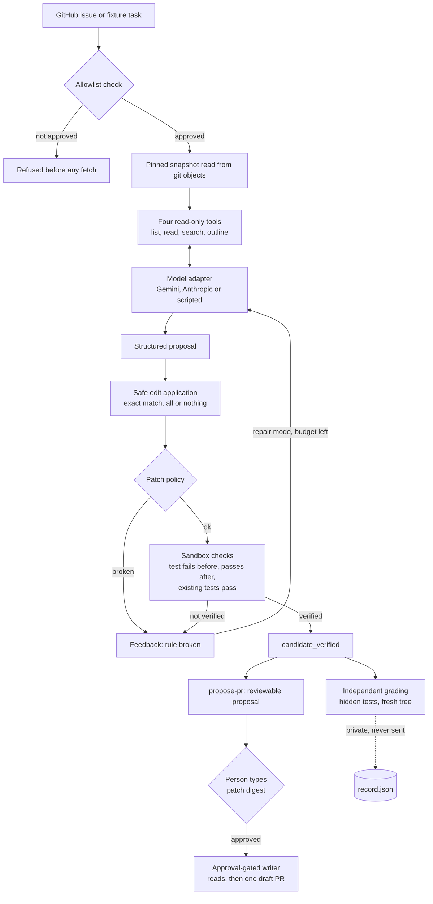

# Architecture

PatchPilot AI turns one bug report for an approved Python repository into
one tested, reviewable patch, and, only after a person approves it, a draft
pull request. The design rule throughout: **safety is enforced in code
outside the model.** The model reads and proposes; everything else is
decided by PatchPilot.

## Trust zones

| Zone | Holds | Trust |
|---|---|---|
| Host orchestrator | CLI, settings, agent loop, patch policy, ledger, traces, model and GitHub clients, credentials | Trusted. Never imports or runs repository code |
| Sandbox container | A copy of the workspace and pytest | Untrusted. No network, no credentials, no host mounts |
| Evaluator | Hidden tests, reference fixes, grading | Trusted. Never reachable by the agent, never fed back to it |
| Hosted demo host | FastAPI demo, Caddy, Docker, the Groq key (AWS EC2) | Trusted host; public only on 80/443 behind an access code |
| Model provider | Groq (hosted demo), Ollama (local), Gemini or Anthropic | External or local service; sees prompts with synthetic task code only; its output is untrusted |

## Data flow

Every model request passes the spend ledger first. In repair mode the state
is checkpointed before every request and after every step.

## Components

| Component | Module | Boundary rule |
|---|---|---|
| CLI | `cli.py` | Live calls need `--live`; GitHub writes need `submit` plus an approval |
| Settings | `config.py` | Validated at start-up; invalid values refused in one line |
| Intake | `intake/` | Allowlist checked before any request; issue text kept as `UntrustedText` |
| Snapshot and tools | `repo/` | Fetched without checkout; paths confined; budgets on calls and output |
| Model adapters | `llm/` | One approved model per process; no fallback; SDK retries off; Groq requests paced and fitted to the free per-minute limit |
| Spend ledger | `llm/budget.py` | Every request reserved before it is sent; failures charged in full |
| Baseline | `agent/baseline.py` | One proposal, no feedback |
| Repair loop | `agent/repair.py` | Up to five proposals; feedback from the agent's own checks only |
| Checkpoints | `agent/checkpoint.py` | JSON, atomic, validated; resume fails closed |
| Patch policy | `patch/` | No test edits, no config files, size limits |
| Sandbox | `sandbox/` | No network, read-only root, non-root user, resource limits |
| Grading | `tasks/` | Rebuilds the tree from pinned tests; only it decides `resolved` |
| Submission | `submit/` | Approval bound to the exact proposal; drafts only; never merges |
| Benchmark | `eval/` | Same tasks and limits for both modes; results labelled |
| Live demo | `demo/` | Built-in synthetic tasks only; access code; per-address, daily and queue limits; one job at a time; listens on 127.0.0.1 |

## Hosted demo

Browser → Caddy (TLS, HSTS, 4 KB bodies) → FastAPI on 127.0.0.1 → one worker
thread → the normal repair pipeline → Groq (`openai/gpt-oss-120b`, free tier)
for each model turn and the Docker sandbox for every check → hidden-test
grading on the host. It runs on one AWS Free-plan `m7i-flex.large` in
`ap-southeast-2`; see [hosted-demo.md](hosted-demo.md) and
[deploy/README.md](../deploy/README.md).

## Key decisions

All in [decisions.md](decisions.md). The ones that shape the system most:

- **Thin provider interface, no gateway library** (record 2); Gemini added
  as a free-tier provider without fallback (record 14).
- **Plain functions and a JSON state machine instead of LangGraph** for the
  repair loop and resume (records 3 and 15).
- **Search-and-replace edits that must match exactly once**, diffs computed
  by PatchPilot, never taken from the model (record 5).
- **Fetch into a bare repository, never check out** (record 11).
- **One attempt or a few, never unbounded**, with caller-owned retries
  (record 13).

## Where the evidence lives

| Artifact | Contents | Shared? |
|---|---|---|
| `trace.jsonl` | Every request and answer, transitions | Local only |
| `checkpoint.json` | Repair state | Local only |
| `record.json` | Final record, hidden-test result | Local; shareable for fixtures |
| `report.md` | Sanitized report | Yes |
| `pr-proposal.md` | What would be sent to GitHub, every file in full | For review |
| `approval.json`, `submission.json` | Who approved what; what was done | Audit |
| `runs/ledger.jsonl` | Reservations and settlements | Local |
